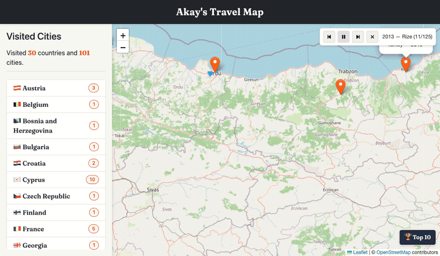
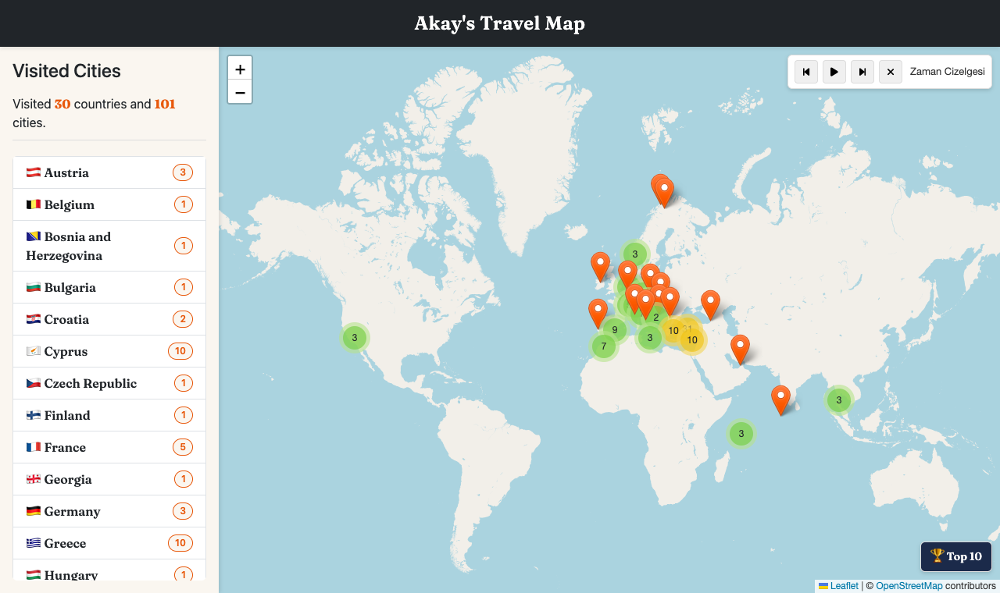

<h1 align="center">🗺️ Akay's Travel Map</h1>

<p align="center">
  Every city our family has visited, on one interactive map, from 1987 to today.
</p>

<p align="center">
  <a href="https://akayibrahim.github.io/akayvisitedcities/"></a>
</p>

<p align="center">
  
  
  
  
  
</p>

<p align="center">
  
  <br/><sub>Timeline playback: the 2013 trip from Madrid to Amsterdam, drawn city by city</sub>
</p>

---

## ✨ Features

| | |
| --- | --- |
| 🌍 **World map** | Clustered markers on OpenStreetMap tiles. Zoom in and clusters split into cities. |
| ⏯️ **Timeline** | Replays every trip in order. The map flies to each city and draws the route from the last one. Play, pause or step through it. |
| 🏳️ **Country list** | Flags and city counts. Expand a country to see its cities, then click one to zoom to it. |
| 🏆 **Top 10** | Our favourite places, one click away. |
| 📱 **Mobile** | The sidebar slides in, and the map fills the screen. |

## 📍 By the numbers

<table>
<tr>
<td valign="top">

**Most visited countries**

| | Country | Cities |
| --- | --- | ---: |
| 🇹🇷 | Turkey | 19 |
| 🇪🇸 | Spain | 9 |
| 🇮🇹 | Italy | 7 |
| 🇲🇦 | Morocco | 7 |
| 🇬🇷 | Greece | 6 |
| 🇨🇭 | Switzerland | 6 |

</td>
<td valign="top">

**Our top 10**

1. 🇲🇻 Maldives
2. 🇸🇨 Seychelles
3. 🇨🇾 Magusa
4. 🇪🇸 Minorca
5. 🇬🇷 Santorini
6. 🇳🇴 Tromsø
7. 🇳🇴 Flåm
8. 🇨🇭 Zurich
9. 🇨🇿 Prague
10. 🇫🇷 Colmar

</td>
</tr>
</table>

<p align="center">
  
</p>

## 🛠️ Tech

Plain HTML, CSS and JavaScript, with no build step and no backend.

- [Leaflet](https://leafletjs.com) and [Leaflet.markercluster](https://github.com/Leaflet/Leaflet.markercluster) for the map
- [OpenStreetMap](https://www.openstreetmap.org) tiles
- Bootstrap 5 and Font Awesome for the layout
- Deployed to **GitHub Pages** by a GitHub Actions workflow on every push to `main`

## ➕ Add a city

Append an entry to the `cities` array in [`script.js`](script.js):

```js
{ name: 'Lisbon', latlng: { lat: 38.7223, lng: -9.1393 }, year: 2026, country: 'Portugal' },
```

A new country also needs its flag in `COUNTRY_FLAGS`. Push to `main` and the map updates in about a minute.
